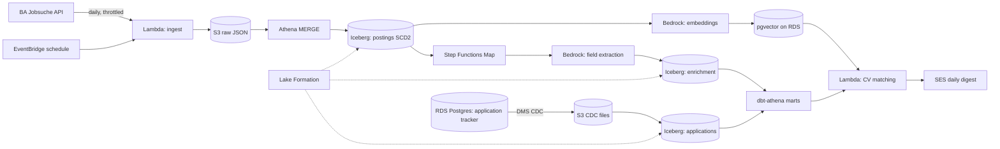

# Stellenradar

**Germany's data-engineering job market, analysed on AWS.**

Stellenradar ("job radar" in German) is a serverless AWS pipeline that collects German data-engineering job postings every day, uses LLMs to turn unstructured job ads into structured insight, and ranks the best-matching roles against a candidate's CV.

> **Status:** 🚧 In development — 3-week build (see [Roadmap](#roadmap))

---

## Why this project

Job ads are unstructured text. Answering simple questions — *Which skills are most in demand? What share of roles are English-only? Which postings mention visa sponsorship? Where does my profile fit best?* — means reading hundreds of ads by hand.

Stellenradar automates that, and doubles as a production-style reference build of a modern AWS data platform: lakehouse, CDC, LLM enrichment, vector search, governance and cost control, all defined in Terraform.

---

## Objectives

### Technical objectives

| # | Objective | Target |
|---|-----------|--------|
| 1 | **Ingest** German data-engineering postings daily into an Iceberg lakehouse on S3, deduplicated and with full change history (SCD2) | Daily run, data freshness < 24h |
| 2 | **Enrich** each posting with an LLM (Amazon Bedrock): skills, seniority, salary, language requirement, visa mentions, remote policy | **≥ 90% field-level accuracy** on a hand-labelled set of 50 postings |
| 3 | **CDC**: replicate a personal application tracker from RDS PostgreSQL to the lake with AWS DMS and join it with market data | Changes visible in the lake within one run window |
| 4 | **Match** postings to a CV using embeddings stored in pgvector | Daily email digest with top 10 ranked matches |
| 5 | **Production quality**: everything in Terraform, least-privilege IAM, no NAT Gateway, Lake Formation governance | Monthly cost target ≤ $30, tracked against actuals |

### Portfolio and career objectives

- Demonstrate hands-on AWS data engineering alongside existing Azure and Databricks experience (multi-cloud).
- Publish a data-driven summary of the German data-engineering job market (top skills, share of English-only roles, salary ranges).
- Use the radar for real: better-targeted job applications.

---

## Scope

### In scope

- Daily batch ingestion from the Bundesagentur für Arbeit job search endpoints (data-engineering-related roles, Germany).
- Raw → curated → marts lakehouse on S3 with Apache Iceberg tables.
- LLM-based extraction of structured fields from job descriptions, with evaluation.
- CDC pipeline from an RDS PostgreSQL application tracker.
- Embedding-based CV matching and a daily email digest.
- Data governance with Lake Formation (table- and column-level permissions).
- Infrastructure as code, CI/CD, cost monitoring and documentation.

### Out of scope

- A public web UI (output is a daily email digest and Athena-queryable marts).
- Scraping other job boards (e.g. LinkedIn, StepStone) — terms of service.
- Automated job applications.
- Real-time streaming — job postings change daily, so batch is the right fit.
- Countries other than Germany.

---

## Architecture



**Region:** `eu-central-1` (Frankfurt)

---

## Tech stack

| Layer | AWS service | Azure equivalent |
|-------|-------------|------------------|
| Storage | S3 | ADLS Gen2 |
| Table format | Apache Iceberg | Delta Lake |
| Catalog | Glue Data Catalog | Unity Catalog metastore |
| Governance | Lake Formation | Unity Catalog permissions |
| Query engine | Athena | Synapse serverless SQL |
| Ingestion compute | Lambda | Azure Functions |
| Scheduling | EventBridge Scheduler | ADF triggers |
| Orchestration | Step Functions | ADF pipelines / Logic Apps |
| CDC | DMS | ADF CDC / Debezium on Event Hubs |
| LLM | Bedrock | Azure OpenAI |
| Vector store | RDS PostgreSQL + pgvector | Azure Database for PostgreSQL + pgvector |
| Transformations | dbt Core (dbt-athena) | dbt (dbt-synapse / dbt-databricks) |
| Secrets | Secrets Manager | Key Vault |
| Notifications | SES | Azure Communication Services |
| IaC | Terraform | Terraform |
| CI/CD | GitHub Actions (OIDC to AWS) | GitHub Actions (OIDC to Azure) |

---

## Data model

| Layer | Table | Description |
|-------|-------|-------------|
| Raw | `raw.postings_json` | API responses as landed, partitioned by ingest date |
| Curated | `curated.postings` | One row per posting version (SCD2), keyed by the posting reference number |
| Curated | `curated.posting_enrichment` | LLM-extracted fields, with model ID and prompt version |
| Curated | `curated.applications` | Application tracker, replicated via CDC |
| Marts | `marts.skill_demand_weekly` | Skill frequency and trend by week |
| Marts | `marts.market_overview` | Share of English-only roles, visa mentions, salary bands |
| Marts | `marts.top_matches_daily` | Ranked matches against the CV |

### Enrichment schema (LLM output)

```json
{
  "skills": ["spark", "airflow", "aws", "dbt"],
  "cloud_platforms": ["aws"],
  "seniority": "senior",
  "salary_min_eur": 70000,
  "salary_max_eur": 90000,
  "german_level_required": "none | basic | fluent",
  "english_only": true,
  "visa_sponsorship_mentioned": true,
  "remote_policy": "onsite | hybrid | remote"
}
```

Every enrichment record stores the `model_id` and `prompt_version` so results stay reproducible when prompts or models change.

---

## Evaluation

LLM extraction is only useful if it is measured.

- 50 postings are labelled by hand and stored in `eval/labelled_set.jsonl`.
- `eval/score.py` compares LLM output to the labels and reports per-field accuracy.
- **Target: ≥ 90% overall field-level accuracy.** Results are recorded per prompt version in `docs/evaluation.md`.

---

## Design decisions

| Decision | Choice | Why |
|----------|--------|-----|
| Table format | Iceberg over Delta | Native support in Athena, Glue and Lake Formation on AWS |
| Vector store | pgvector over OpenSearch Serverless | OpenSearch Serverless has a minimum hourly cost; pgvector reuses the RDS instance already needed for CDC |
| Networking | No NAT Gateway | S3 gateway endpoint (free); interface endpoints only where a VPC-bound component needs them |
| Processing mode | Daily batch, not streaming | Postings change daily; streaming would add cost without value |
| dbt execution | GitHub Actions with OIDC | No long-lived AWS keys; no always-on compute |

Detailed records live in `docs/decisions/`.

---

## Cost and security guardrails

- AWS Budgets alerts at $10, $25 and $50.
- Monthly cost target ≤ $30; actuals tracked in `docs/costs.md`.
- RDS and DMS stopped outside run windows.
- Least-privilege IAM roles per component; no IAM users with access keys.
- Secrets in Secrets Manager; S3 buckets encrypted, public access blocked.
- All resources tagged `project=stellenradar` and removable with `terraform destroy`.

---

## Data source and responsible use

Job data comes from the job search endpoints of the Bundesagentur für Arbeit (German Federal Employment Agency). The agency does not publish an official API; the endpoints are documented by the community project [bundesAPI/jobsuche-api](https://github.com/bundesAPI/jobsuche-api).

- Requests are throttled and run once a day.
- Raw postings stay in a private bucket and are not republished.
- Only aggregated statistics are shared publicly.

---

## Repository structure

```
stellenradar/
├── infra/                  # Terraform: bootstrap/, modules/, envs/dev/ (see infra/README.md)
├── src/                    # Lambda code, one package per function
│   ├── common/             # shared logging and S3 helpers
│   ├── ingest/             # BA job search → raw S3
│   └── curate/             # SCD2 merge into Iceberg via Athena (SQL in curate/sql/)
├── tests/unit/             # pytest, no network or AWS needed
├── dbt/                    # dbt-athena project (Week 3)
├── eval/                   # Labelled set + scoring script (Week 2)
├── spikes/                 # Throw-away investigation scripts (raw output git-ignored)
├── docs/                   # PRD, design, ADRs, spikes, costs, evaluation
└── .github/workflows/      # ci.yml (lint + tests), terraform.yml (plan on PR, apply on main)
```

Further packages (`enrich`, `embed`, `match`, …) are added under `src/` as they are built – see [SDD §2](docs/03-sdd.md).

---

## Roadmap

### Week 1 — Foundation and ingestion
- [ ] Terraform: S3 layers, IAM roles, VPC with S3 gateway endpoint, budget alerts
- [ ] Lambda ingest on an EventBridge schedule → S3 raw
- [ ] Glue Catalog + Iceberg `curated.postings` with SCD2 MERGE via Athena

### Week 2 — Enrichment, CDC and matching
- [ ] Step Functions Map state calling Bedrock, with retries and throttling
- [ ] Labelled evaluation set and scoring script
- [ ] RDS PostgreSQL tracker + DMS CDC to S3 → `curated.applications`
- [ ] Embeddings + pgvector CV matching

### Week 3 — Marts, governance and publishing
- [ ] dbt-athena marts, run via GitHub Actions (OIDC)
- [ ] Lake Formation table- and column-level permissions
- [ ] SES daily digest
- [ ] Architecture diagram, cost breakdown, evaluation results
- [ ] Publish market findings

---

## Success criteria

The project is complete when:

1. The pipeline runs daily without manual intervention.
2. LLM extraction reaches ≥ 90% accuracy on the labelled set.
3. The daily digest delivers ranked matches.
4. Monthly cost stays within the target and is documented.
5. This README includes the final architecture, cost breakdown and market findings.

---

## Market findings

*Coming at the end of Week 3: top skills, share of English-only roles, visa-sponsorship mentions and salary bands for data-engineering roles in Germany.*

---

## Author

**Prabhu Saravanan** — Lead Data Engineer (Azure · Databricks · AWS)

[LinkedIn](#) · [Portfolio](#)

## License

MIT