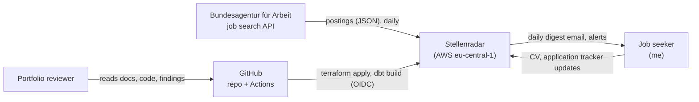
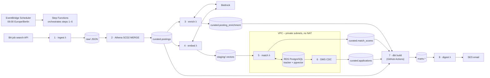
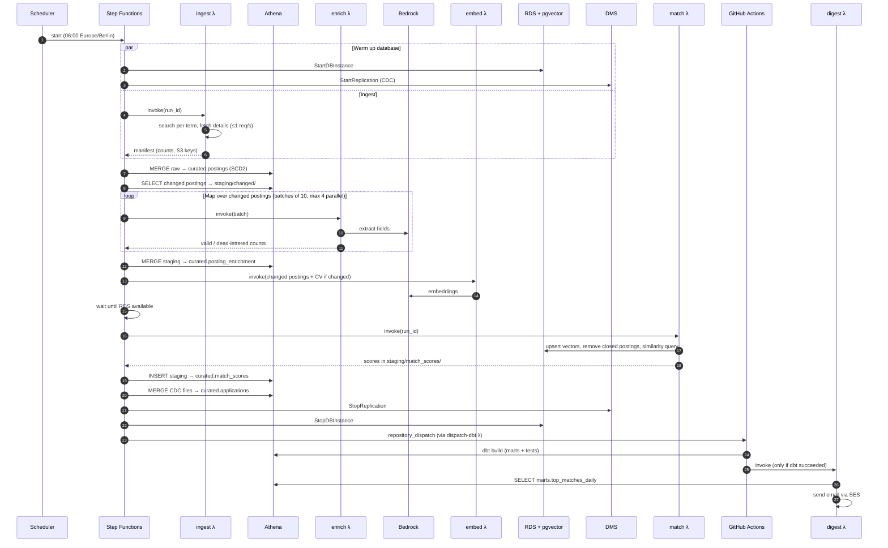
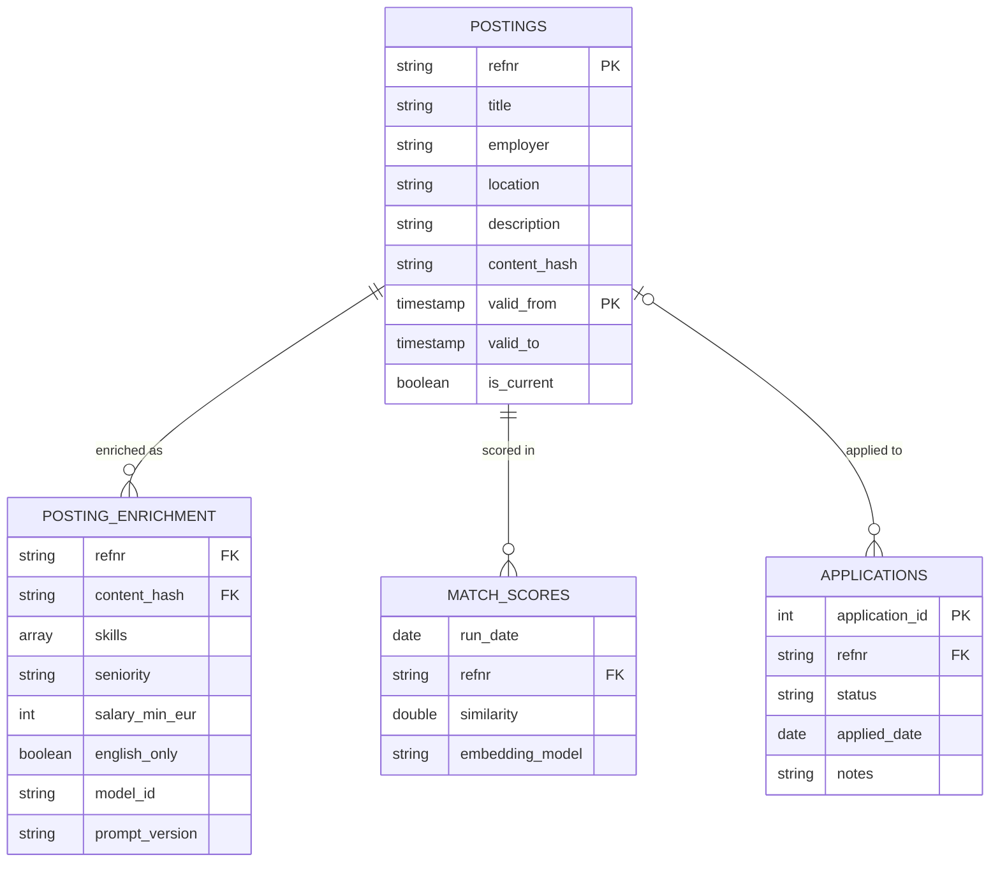
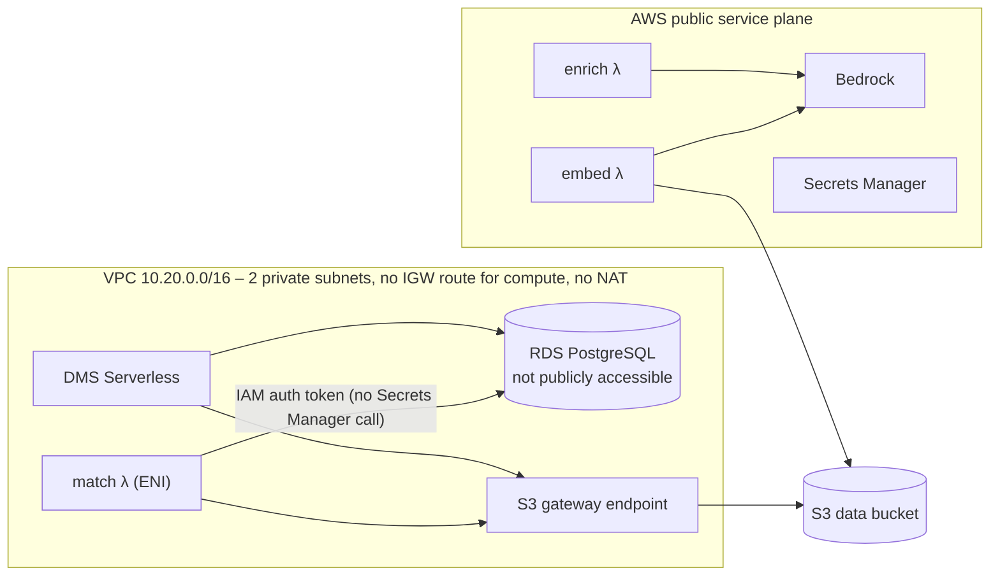

# Stellenradar – System Design (HLD)

| Version | Date | Author | Status |
|---|---|---|---|
| 0.1 | 2026-10-19 | Prabhu Saravanan | Draft – in review |

Related documents: [PRD](01-prd.md) · ADRs (`decisions/`, planned) · SDD (`03-sdd.md`, planned)

This document describes **what the components are, how data flows between them, and why the system is shaped this way**. Component internals (code structure, SQL, prompts, Terraform modules) belong in the SDD.

---

## 1. Context



| External system | Interaction | Direction |
|---|---|---|
| BA job search API | Paginated job search + job detail, once per day, throttled | Inbound |
| Job seeker | Uploads CV to S3; edits application tracker in PostgreSQL; receives email | Both |
| GitHub Actions | Deploys Terraform; runs dbt; triggers digest. Authenticates with OIDC | Inbound |
| SES (email) | Sends digest and alert emails to one verified address | Outbound |

## 2. Design principles

1. **Serverless and pay-per-use first.** Nothing runs between pipeline runs except storage. (NFR-03)
2. **Raw is immutable.** Every API response is kept as landed so any later layer can be rebuilt. (R1)
3. **Idempotent daily runs.** Re-running a day produces the same tables, with no duplicates. (NFR-02)
4. **Only process what changed.** Enrichment and embeddings run only for new or changed postings. (FR-09)
5. **No NAT Gateway.** Components that need the internet stay outside the VPC; components inside the VPC only use the free S3 gateway endpoint. (NFR-08)
6. **One orchestrator for AWS work.** Step Functions owns the daily run end to end; GitHub Actions only runs dbt and the digest.
7. **Everything in Terraform**, tagged `project=stellenradar`. (NFR-05)

## 3. Architecture overview



Step Functions runs steps 1–6 and then triggers step 7; step 7 triggers step 8 on success (see §4). Lake Formation governs every `curated` and `marts` table; all S3 traffic from the VPC goes through the S3 gateway endpoint.

### Component summary

| # | Component | AWS service | Responsibility | PRD |
|---|---|---|---|---|
| C1 | Scheduler | EventBridge Scheduler | Starts the daily state machine at 06:00 Europe/Berlin (timezone-aware, DST-safe) | FR-01 |
| C2 | Orchestrator | Step Functions (Standard) | Runs all AWS steps in order, retries, catches failures, starts/stops RDS and DMS | FR-22, FR-24 |
| C3 | Ingest | Lambda (Python, outside VPC) | Calls the BA API per search term, writes raw JSON + a run manifest to S3 | FR-01–03 |
| C4 | Curate | Athena (via Step Functions SDK integration) | SCD2 `MERGE` from raw into `curated.postings`; writes the list of changed postings | FR-04, FR-05 |
| C5 | Enrich | Lambda (outside VPC) in a Step Functions Map | Calls Bedrock for each changed posting, validates JSON, writes to staging | FR-06–09 |
| C6 | Embed | Lambda (outside VPC) | Creates embeddings for changed postings and the CV, writes vectors to staging | FR-14 |
| C7 | Match | Lambda **inside VPC** | Loads vectors into pgvector, computes similarity scores, writes scores to staging | FR-14–16 |
| C8 | Tracker DB | RDS PostgreSQL (smallest class) + pgvector | Application tracker (CDC source) and vector store | FR-11, FR-14 |
| C9 | CDC | DMS Serverless | Replicates tracker changes to S3 as Parquet | FR-12 |
| C10 | Transform | dbt-athena on GitHub Actions | Builds marts and runs data tests | FR-18–21 |
| C11 | Digest | Lambda (outside VPC) + SES | Reads `marts.top_matches_daily`, sends the email | FR-17 |
| C12 | Catalog and governance | Glue Data Catalog + Lake Formation | Table metadata; table- and column-level permissions | FR-23 |
| C13 | Alerting | EventBridge rules + SNS (email) + AWS Budgets | Pipeline failure, freshness and cost alerts | FR-22, NFR-03 |
| C14 | Secrets | Secrets Manager | DB master password, GitHub dispatch token | NFR-07 |

## 4. Daily run – end-to-end flow



**Expected duration:** 20–40 minutes, dominated by RDS start-up (~5–10 min, overlapped with ingest) and the BA API throttle. The digest should arrive by about 07:00.

**Failure path:** every Step Functions task has a `Retry` (exponential backoff) and a `Catch` that goes to a cleanup branch: stop DMS, stop RDS, publish to the SNS alert topic, then fail the execution. dbt failures are reported by GitHub Actions; no digest is sent when dbt fails, so I never receive stale or partial matches.

## 5. Data architecture

### 5.1 Layers and storage

| Layer | Glue database | Format | Written by | Partitioning | Retention |
|---|---|---|---|---|---|
| Raw | `raw` | JSON (gzip), external table | ingest λ | `ingest_date` | Keep (small; needed for replay) |
| Staging | `staging` | JSONL / Parquet, external tables | enrich, embed, match λ; DMS | `run_id` | 30 days (lifecycle rule) |
| Curated | `curated` | Apache Iceberg | Athena MERGE | see SDD | Keep, Iceberg snapshots expired after 7 days |
| Marts | `marts` | Apache Iceberg | dbt-athena | by week/day where useful | Keep |
| Athena results | – | CSV | Athena | – | 7 days |

S3 layout (one data bucket + one results bucket + one config bucket):

```
s3://stellenradar-<account>-data/
  raw/postings/ingest_date=YYYY-MM-DD/run_id=<id>/search_*.json.gz
  raw/postings/ingest_date=YYYY-MM-DD/run_id=<id>/details_*.json.gz
  raw/manifests/run_id=<id>.json
  staging/{changed,enrichment,embeddings,match_scores,dead_letter}/run_id=<id>/...
  cdc/applications/...                  # DMS output
  curated/{postings,posting_enrichment,applications,match_scores}/   # Iceberg
  marts/{skill_demand_weekly,market_overview,top_matches_daily,...}/ # Iceberg
s3://stellenradar-<account>-config/
  cv/cv.md                              # personal – restricted
s3://stellenradar-<account>-athena-results/
```

### 5.2 Core entities



**Change detection:** a posting "changes" when the hash of its business fields (title, employer, location, description, salary text, …) differs from the current row. Enrichment is keyed by `(refnr, content_hash)`, so an unchanged posting is never sent to Bedrock twice (FR-09). Full column definitions are in the data model document.

### 5.3 Data volume estimate

| Item | Estimate | Basis |
|---|---|---|
| Active postings matching the search terms | 2,000–5,000 | Assumption A2 – verify in Week 1 |
| New or changed per day | 50–300 | Assumption A2 |
| Raw data per day | < 20 MB | ~5 KB per detail record |
| Bedrock extraction calls per day | 50–300 | Changed postings only |
| Vectors in pgvector | ≤ 5,000 × 1,024 dims | ~20 MB – fits the smallest RDS class |

This is small data. Every design choice favours low fixed cost over throughput.

## 6. Key design decisions

Each decision below gets its own ADR in `docs/decisions/`. This section answers PRD open questions Q2, Q3 and Q4.

### 6.1 Networking: split "talk to the internet" from "talk to the database" (answers Q3)

Without a NAT Gateway, a Lambda inside the VPC cannot reach Bedrock, the BA API or GitHub. Interface endpoints would fix that but cost about $7–8 per month **each** per AZ, which breaks the budget.

**Decision:** only the `match` Lambda and DMS live in the VPC. They talk to S3 through the free gateway endpoint and to RDS directly. Everything that needs Bedrock or the internet (`ingest`, `enrich`, `embed`, `dispatch-dbt`, `digest`) runs outside the VPC and hands data over through S3 staging.



- The `match` Lambda connects with **RDS IAM database authentication**. The token is signed locally with the Lambda's role, so it needs no network call to Secrets Manager and no interface endpoint.
- DMS reads its source credentials when the endpoint is created/started; how it does so without an endpoint is confirmed in the SDD spike (see §10).
- Two private subnets in two AZs are required by the RDS subnet group; RDS itself is single-AZ.

### 6.2 Orchestration: Step Functions for AWS, GitHub Actions for dbt

| Option | Pros | Cons |
|---|---|---|
| **A. Step Functions + dbt on GitHub Actions (chosen)** | No always-on compute; dbt runs where the code lives; OIDC, no keys | Two orchestrators to correlate |
| B. MWAA (Airflow) | One orchestrator, familiar | Minimum ~$350/month – far over budget |
| C. dbt inside a Lambda/ECS task | One orchestrator | Packaging dbt for Lambda is fragile; ECS adds networking and cost |

To avoid timing guesswork between the two, Step Functions ends by sending a GitHub `repository_dispatch` event (token from Secrets Manager). The dbt workflow starts immediately, and only invokes the digest when `dbt build` succeeds. A daily GitHub cron at 09:00 acts as a fallback that exits early if the run already happened.

### 6.3 Bedrock models and region (answers Q2)

| Use | Model (proposed) | Why |
|---|---|---|
| Field extraction | A small, low-cost Claude model (Haiku class) through the **EU cross-region inference profile** | Good structured-output quality on German text at low cost. The EU profile keeps processing inside EU regions |
| Embeddings | Amazon Titan Text Embeddings V2 (1,024 dims) | Available in eu-central-1, multilingual – the CV is English, most ads are German |

Using an EU inference profile means requests may be served from another **EU** region. This is a documented exception to NFR-04 and gets its own ADR. Exact model IDs are confirmed against the Bedrock console in Step 0 and pinned in configuration, never hard-coded.

### 6.4 Database runs only when needed (answers Q4)

| Time (Europe/Berlin) | What runs |
|---|---|
| 06:00 | Pipeline starts, RDS and DMS start |
| ~06:30 | Matching done, CDC merged, RDS and DMS stopped |
| ~06:45 | dbt build |
| ~07:00 | Digest email |
| On demand | I start RDS (`make db-up`) to update the tracker; an EventBridge schedule stops it at 22:00 if still running |

Changes I make to the tracker while DMS is stopped stay in the PostgreSQL logical replication slot and are picked up the next morning – within one run window (SM-04).

### 6.5 Other decisions

| Decision | Choice | Main reason |
|---|---|---|
| Table format | Apache Iceberg | Native `MERGE` in Athena; supported by Glue and Lake Formation |
| Vector store | pgvector on the RDS instance already needed for CDC | OpenSearch Serverless has a minimum hourly cost |
| CDC service | DMS Serverless, started/stopped by the pipeline | Billed only while replicating; a provisioned instance bills 24/7. Cost verified in the cost model |
| Environments | One environment (`dev`) | Budget; Terraform modules allow a second env later |
| Terraform state | S3 backend with native lockfile (`use_lockfile`) | No DynamoDB table needed |
| Encryption | SSE-S3 on buckets, AWS-managed key on RDS | Customer-managed KMS keys cost $1/month each with no benefit at this scale |

## 7. Security and governance (summary)

Details go in `05-security.md`.

| Area | Design |
|---|---|
| Identity | One IAM role per component, scoped to its own prefixes and actions. No IAM users. Humans use IAM Identity Center |
| CI/CD | GitHub OIDC → two roles: `gha-terraform` (deploy, only from `main` and PRs plan-only) and `gha-dbt` (Athena, Glue, Lake Formation data access, invoke digest) |
| Data access | Lake Formation manages `curated` and `marts`. `curated.applications.notes` and the CV are visible only to the roles that need them. A read-only `analyst` role can query marts only |
| Network | RDS not publicly accessible; security group allows 5432 only from the `match` Lambda and DMS security groups |
| Secrets | Secrets Manager for the RDS master password and GitHub token. Lambda environment variables hold no secrets |
| Data protection | All buckets block public access and enforce TLS. Raw postings and personal data never leave private buckets |

## 8. Reliability and operations

| Concern | Approach |
|---|---|
| Idempotency | Every run has a `run_id`. Raw writes are keyed by `run_id`; `MERGE` statements are deterministic; re-running a date replaces staging for that `run_id` |
| Retries | Step Functions retry with backoff on Lambda, Athena and Bedrock throttling errors. Per-posting failures go to `staging/dead_letter/` and do not fail the run |
| Partial failure | If enrichment fails for < 10% of postings, the run continues and reports the count. Above 10%, the run fails |
| Backfill / replay | Curated tables can be rebuilt from raw by re-running the curate step for a date range |
| Alerts | SNS email on: Step Functions execution failed; GitHub Actions dbt failure (GitHub notification); no successful run in 26 h (CloudWatch alarm on a custom metric); budget thresholds $10 / $25 / $50 |
| Observability | Structured JSON logs with `run_id` in every component. Per-run counts (fetched, new, changed, closed, enriched, dead-lettered, matched) written to the manifest and as CloudWatch metrics |
| Cost guardrails | Athena workgroup with a per-query scan limit; Step Functions Map concurrency limit; S3 lifecycle on staging and results; RDS/DMS stopped outside windows |

## 9. How the design meets the non-functional requirements

| NFR | How |
|---|---|
| NFR-01 Freshness < 24 h | Daily 06:00 run; freshness alarm at 26 h |
| NFR-02 Reliability ≥ 95% | Retries, catch-and-cleanup, idempotent steps, dead-letter for single postings |
| NFR-03 Cost ≤ $30 | No NAT, no interface endpoints, no always-on compute, RDS/DMS stopped, changed-only enrichment, budget alerts |
| NFR-04 Region | All resources in eu-central-1; EU inference profile documented as an exception (ADR) |
| NFR-05 IaC | All of the above in Terraform modules under `infra/` |
| NFR-06/07 Security | Per-component roles, OIDC, Secrets Manager, private RDS, encrypted buckets |
| NFR-08 Networking | §6.1 |
| NFR-09 Responsible use | Single daily run, ≤ 1 request/s, descriptive User-Agent, raw data private |
| NFR-10 Privacy | CV and tracker in restricted locations; Lake Formation column restrictions; only aggregates published |
| NFR-11 Reproducibility | Prompts in Git; `model_id` and `prompt_version` on every enrichment row |
| NFR-12 Quality | CI lint + unit tests; dbt tests in every build |
| NFR-13 Observability | §8 |

## 10. Risks and spikes to run before building

These are design assumptions that must be checked early in Week 1. Each takes less than half a day.

| Spike | Question | If it fails |
|---|---|---|
| S1 – BA API | Do the search and job-detail endpoints still return the full description text? What are the page size and rate limits? | Enrich from the fields available in search results; record in an ADR (PRD R1) |
| S2 – Bedrock access | Which Claude and embedding model IDs are enabled in eu-central-1 or via the EU inference profile? | Pick the nearest available model; update §6.3 |
| S3 – DMS without endpoints | Can DMS Serverless in private subnets read its source credentials and write to S3 with only the gateway endpoint? Does it bill only while replicating? | Fall back to a provisioned `dms.t3.micro` created and deleted by the pipeline |
| S4 – Athena MERGE | Does Athena `MERGE INTO` on Iceberg handle the SCD2 pattern (close old row + insert new row) in one statement, or does it need two? | Two statements in one Step Functions step |

## 11. ADRs to write next

| ADR | Title |
|---|---|
| ADR-001 | Apache Iceberg as table format |
| ADR-002 | pgvector on RDS instead of OpenSearch Serverless |
| ADR-003 | No NAT Gateway: split internet-facing and VPC-bound Lambdas |
| ADR-004 | Step Functions for orchestration, dbt on GitHub Actions via `repository_dispatch` |
| ADR-005 | Bedrock models and EU cross-region inference profile |
| ADR-006 | DMS Serverless, started and stopped per run |
| ADR-007 | RDS IAM authentication for VPC Lambdas |
| ADR-008 | Single `dev` environment |
