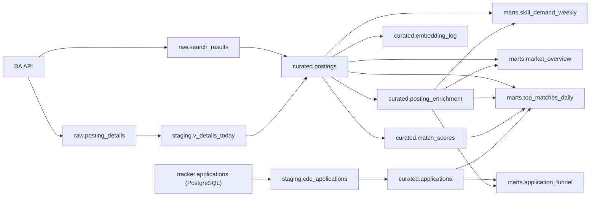

# Stellenradar – Data Model and Data Contracts

| Version | Date | Author | Status |
|---|---|---|---|
| 0.1 | 2026-10-20 | Prabhu Saravanan | Draft – in review |

Related documents: [System Design §5](02-system-design.md) · [SDD §4](03-sdd.md) · [Security](05-security.md)

This document is the data dictionary: every table, every column, who writes it, how it is keyed, and which quality rules apply. When the SDD and this document disagree on a column, **this document wins** and the SDD is corrected.

---

## 1. Conventions

| Topic | Rule |
|---|---|
| Naming | `snake_case`; tables plural for entities (`postings`), singular nouns for facts with a grain suffix (`skill_demand_weekly`) |
| Keys | Natural key from the source where one exists (`refnr`, `application_id`); no surrogate keys in the lake |
| Time | `timestamp(6)` in UTC; business dates (`run_date`, `iso_week`) are Europe/Berlin calendar dates |
| Enums | Lower-case English strings, validated by schema and dbt `accepted_values` |
| Nulls | `null` means "not stated / unknown", never "zero" or "false by default" |
| Formats | Raw: gzip JSON. Staging: JSONL / Parquet / CSV. Curated and marts: Apache Iceberg v2, Parquet, zstd |
| Glue database names | This document uses the short layer names (`raw`, `staging`, `curated`, `marts`). In AWS they are prefixed to avoid clashes with other workloads in the account: `stellenradar_raw`, `stellenradar_staging`, `stellenradar_curated`, `stellenradar_marts`. SQL and dbt take the prefix from configuration |

### Data classification

Every column below carries one of these classes; the [security doc](05-security.md) defines the controls per class.

| Class | Meaning | Examples |
|---|---|---|
| **Public** | Published job-ad content or aggregates safe to share | title, skills, market shares |
| **Internal** | Derived or operational data, not secret but not published | similarity scores, run IDs, token counts |
| **Personal** | Data about me or identifiable people – never published, access-restricted | CV text and vector, tracker `notes`, contact names inside ad text |

> Job-ad descriptions are public on the BA portal, but some contain a recruiter's name or phone number. They are therefore treated as **Personal** in raw and curated layers, and only aggregates leave the platform (PRD NFR-10).

## 2. Lineage

## 3. Raw layer (Glue database `raw`)

External tables over gzip JSON, partition projection on `ingest_date` (date) and `run_id` (injected). Written only by the ingest Lambda; never updated.

### 3.1 `raw.search_results`

One row per posting per search page per run, from `ergebnisliste` of `/pc/v6/jobs`. Field names are the BA's, exactly as returned ([spike S1](spikes/S1-ba-api.md)). Only the columns the pipeline uses are listed; the raw JSON keeps all fields.

| Column | Type | Class | Description |
|---|---|---|---|
| `referenznummer` | string | Public | BA reference number – the posting's natural key (`refnr` in pipeline tables) |
| `stellenangebotsTitel` | string | Public | Ad title |
| `firma` | string | Public | Employer name |
| `stellenlokationen` | array<struct> | Public | Work location(s) |
| `hauptberuf` | string | Public | Main occupation classification |
| `aenderungsdatum` | string (timestamp) | Public | Last modification at source – part of the list hash |
| `datumErsteVeroeffentlichung` | string (date) | Public | First publication date |
| `verguetungsangabe` | string | Public | Structured pay information, if any |
| `homeofficemoeglich` | boolean | Public | Home office possible |
| `externeURL` | string | Public | Set when the ad is hosted on an external site |
| `search_term` | string | Internal | Search term that returned this row (added by ingest) |
| `list_hash` | string | Internal | SHA-256 of the canonical list fields (added by ingest) |
| `ingest_date` | date (partition) | Internal | Business date of the run |
| `run_id` | string (partition) | Internal | Execution that wrote it |

### 3.2 `raw.posting_details`

One row per fetched detail record from `/pc/v4/jobdetails/{base64(referenznummer)}`. Detail records contain all search fields plus the ones below. The staging view `staging.v_details_today` maps them to pipeline names:

| Raw column | → Pipeline column | Class | Description |
|---|---|---|---|
| `referenznummer` | `refnr` | Public | Natural key |
| `stellenangebotsTitel` | `title` | Public | Title |
| `firma` | `employer` | Public | Employer |
| `stellenlokationen` (first entry, city + postcode) | `location` | Public | Location as text |
| `stellenangebotsBeschreibung` | `description` | **Personal** | Full ad text (may contain contact names) |
| `verguetungsangabe` | `salary_text` | Public | Pay information if present |
| `arbeitszeitVollzeit` / `arbeitszeitTeilzeit*` | `employment_type` | Public | Derived: full-time / part-time |
| `homeofficemoeglich` | `homeoffice_possible` | Public | Structured flag – cross-check for the LLM's `remote_policy` |
| `datumErsteVeroeffentlichung` | `published_at` | Public | First publication date |
| `istArbeitnehmerUeberlassung` | `is_temp_agency` | Public | Temporary employment agency posting |
| (derived) | `source_url` | Public | `https://www.arbeitsagentur.de/jobsuche/jobdetail/<referenznummer>` |
| `ingest_date`, `run_id` | partitions | Internal | As above |

### 3.3 Run manifests and state

| Object | Format | Purpose |
|---|---|---|
| `raw/manifests/run_id=<id>.json` | JSON | Per-run counts and `complete` flag ([SDD §4.1](03-sdd.md)) |
| `raw/state/list_index.json.gz` | JSON map `refnr → list_hash` | Change detection between runs |
| `cdc/_state/checkpoint.json` | JSON | Last DMS `RecoveryCheckpoint` ([ADR-009](decisions/ADR-009-dms-instance-per-run.md)) |

## 4. Curated layer (Glue database `curated`, Iceberg)

### 4.1 `curated.postings` – SCD Type 2

**Grain:** one row per version of a posting. **Primary key:** `(refnr, valid_from)`. **Writer:** Step Functions (Athena SCD2 statements). **Partitioning:** `bucket(16, refnr)`.

| Column | Type | Null | Class | Description |
|---|---|---|---|---|
| `refnr` | string | no | Public | BA reference number |
| `title` | string | no | Public | |
| `employer` | string | yes | Public | |
| `location` | string | yes | Public | |
| `description` | string | yes | **Personal** | Normalised ad text |
| `salary_text` | string | yes | Public | |
| `employment_type` | string | yes | Public | |
| `homeoffice_possible` | boolean | yes | Public | BA structured flag |
| `is_temp_agency` | boolean | yes | Public | Temporary employment agency posting |
| `published_at` | date | yes | Public | |
| `source_url` | string | yes | Public | |
| `content_hash` | string | no | Internal | SHA-256 over business fields; defines a "version" |
| `raw_s3_key` | string | no | Internal | Raw file holding this version's detail record |
| `valid_from` | timestamp(6) | no | Internal | Version start (run's `ingested_at`) |
| `valid_to` | timestamp(6) | yes | Internal | Version end; `null` while current |
| `is_current` | boolean | no | Internal | `true` for exactly one row per active `refnr` |
| `run_id` | string | no | Internal | Run that created the version |

**Rules:** at most one `is_current = true` row per `refnr`; `valid_to` is null ⇔ `is_current`; `valid_from < valid_to`; versions of a `refnr` do not overlap.

### 4.2 `curated.posting_enrichment`

**Grain:** one row per posting version per prompt version. **Primary key:** `(refnr, content_hash, prompt_version)`. **Writer:** Step Functions (`MERGE` from enrich staging). **Partitioning:** none (small).

| Column | Type | Null | Class | Description |
|---|---|---|---|---|
| `refnr` | string | no | Public | FK → `postings.refnr` |
| `content_hash` | string | no | Internal | FK → the posting version |
| `prompt_version` | string | no | Internal | e.g. `v1` |
| `model_id` | string | no | Internal | Bedrock model / inference profile ID |
| `skills` | array<string> | no (may be empty) | Public | Normalised skill names |
| `cloud_platforms` | array<string> | no (may be empty) | Public | Subset of `aws`, `azure`, `gcp` |
| `seniority` | string | yes | Public | `junior`, `mid`, `senior`, `lead`, `principal` |
| `salary_min_eur` | int | yes | Public | Yearly EUR, only if stated |
| `salary_max_eur` | int | yes | Public | Yearly EUR, only if stated |
| `german_level_required` | string | no | Public | `none`, `basic`, `fluent` |
| `english_only` | boolean | no | Public | |
| `visa_sponsorship_mentioned` | boolean | no | Public | |
| `remote_policy` | string | yes | Public | `onsite`, `hybrid`, `remote` |
| `input_tokens` | int | no | Internal | Bedrock usage |
| `output_tokens` | int | no | Internal | Bedrock usage |
| `enriched_at` | timestamp(6) | no | Internal | |
| `run_id` | string | no | Internal | |

**Rules:** `salary_min_eur ≤ salary_max_eur` when both present; salaries within 10,000–400,000; enums valid; every current posting has a row for the active prompt version after a successful run, except dead-lettered ones (≤ 10%).

### 4.3 `curated.embedding_log`

**Grain:** one row per embedded posting version per model. **Primary key:** `(refnr, content_hash, model_id)`. Records which versions already have vectors so the embed step never repeats work. The vectors themselves live in PostgreSQL (§6).

| Column | Type | Class | Description |
|---|---|---|---|
| `refnr`, `content_hash` | string | Public / Internal | Posting version |
| `model_id` | string | Internal | Embedding model ID |
| `s3_key` | string | Internal | Staging file containing the vector |
| `embedded_at` | timestamp(6) | Internal | |

### 4.4 `curated.match_scores`

**Grain:** one row per run date per scored posting (top 300). **Primary key:** `(run_date, refnr)`. **Partitioning:** `month(run_date)`.

| Column | Type | Class | Description |
|---|---|---|---|
| `run_date` | date | Internal | |
| `refnr` | string | Public | |
| `similarity` | double | Internal | Cosine similarity to the CV, 0–1 |
| `model_id` | string | Internal | Embedding model |
| `run_id` | string | Internal | |

### 4.5 `curated.applications` – CDC target

**Grain:** one row per application (current state; deletes are soft). **Primary key:** `application_id`. **Writer:** Step Functions (`MERGE` from `staging.cdc_applications`).

| Column | Type | Null | Class | Description |
|---|---|---|---|---|
| `application_id` | bigint | no | Internal | Source primary key |
| `refnr` | string | yes | Public | Link to a posting when known |
| `company` | string | no | Personal | My application target |
| `role_title` | string | no | Personal | |
| `applied_date` | date | no | Personal | |
| `status` | string | no | Personal | `applied`, `screening`, `interview`, `offer`, `rejected`, `withdrawn`, `ghosted` |
| `source` | string | yes | Personal | Where I found the role |
| `notes` | string | yes | **Personal – restricted column** | Free text; Lake Formation hides it from all roles except the pipeline |
| `is_deleted` | boolean | no | Internal | Soft delete from CDC `Op = D` |
| `source_commit_ts` | timestamp(6) | no | Internal | Commit time of the last applied change (watermark) |

> The whole table is Personal because it describes my job search; only `notes` is column-restricted because it may mention people by name.

## 5. Marts layer (Glue database `marts`, Iceberg, built by dbt)

| Mart | Grain | Key | Class | Shared publicly? |
|---|---|---|---|---|
| `skill_demand_weekly` | ISO week × skill | `(iso_week, skill)` | Public | Yes (aggregates) |
| `market_overview` | ISO week | `iso_week` | Public | Yes (aggregates) |
| `top_matches_daily` | run date × rank | `(run_date, rank)` | Internal | No |
| `application_funnel` | status × seniority × skill | `(status, seniority, skill)` | Personal | No |

### 5.1 `marts.skill_demand_weekly`

| Column | Type | Description |
|---|---|---|
| `iso_week` | date | Monday of the ISO week |
| `skill` | string | Normalised skill |
| `postings` | int | Current postings in that week mentioning the skill |
| `share_of_postings` | double | `postings / total postings that week` |
| `wow_change` | double | Week-over-week change in share (percentage points) |

### 5.2 `marts.market_overview`

| Column | Type | Description |
|---|---|---|
| `iso_week` | date | |
| `postings_total` | int | Distinct current postings |
| `english_only_share` | double | |
| `visa_mention_share` | double | |
| `salary_stated_share` | double | Share with any salary stated |
| `salary_p25_eur`, `salary_p50_eur`, `salary_p75_eur` | int | Percentiles of salary midpoints, where stated; null if < 20 postings state a salary |
| `remote_share`, `hybrid_share`, `onsite_share`, `remote_unknown_share` | double | Sum to 1.0 |

### 5.3 `marts.top_matches_daily`

| Column | Type | Description |
|---|---|---|
| `run_date` | date | |
| `rank` | int | 1–10 |
| `refnr` | string | |
| `title`, `employer`, `location`, `source_url` | string | For the digest |
| `seniority`, `german_level_required`, `remote_policy` | string | |
| `top_skills` | array<string> | Up to 8 |
| `salary_min_eur`, `salary_max_eur` | int | If stated |
| `similarity`, `rule_score`, `final_score` | double | Ranking components ([SDD §4.8](03-sdd.md)) |

### 5.4 `marts.application_funnel`

| Column | Type | Description |
|---|---|---|
| `status` | string | Current application status |
| `seniority` | string | From enrichment of the linked posting (`unknown` if unlinked) |
| `skill` | string | Each skill of the linked posting |
| `applications` | int | Count of non-deleted applications |

## 6. Operational store – RDS PostgreSQL

| Schema.table | Purpose | Class | Replicated to lake? |
|---|---|---|---|
| `tracker.applications` | Application tracker (DDL in [SDD §4.6](03-sdd.md)) | Personal | Yes, via DMS → `curated.applications` |
| `vec.posting_vectors` | 1,024-dim vectors per current posting | Internal | No |
| `vec.cv_vector` | Single CV vector | **Personal** | No |
| `public.schema_migrations` | Applied migration versions | Internal | No |

## 7. Data quality rules

| ID | Table | Rule | Where enforced | On failure |
|---|---|---|---|---|
| DQ-01 | `raw` manifest | `complete = true` before closing postings | Step Functions Choice | Skip closures, warn |
| DQ-02 | `curated.postings` | ≤ 1 current row per `refnr` | dbt test on source | dbt fails → no digest |
| DQ-03 | `curated.postings` | `is_current` ⇔ `valid_to is null` | dbt test | dbt fails |
| DQ-04 | `curated.postings` | Freshness: max `valid_from` or latest manifest < 26 h | dbt source freshness | warn 26 h, error 48 h |
| DQ-05 | `curated.posting_enrichment` | Enums valid, salary range, min ≤ max | Enrich `validate()` + dbt tests | Dead letter / dbt fails |
| DQ-06 | `curated.posting_enrichment` | Dead-letter rate ≤ 10% per run | Distributed Map tolerance + metric | Run fails above 10% |
| DQ-07 | `curated.applications` | `application_id` unique; `status` valid | dbt tests | dbt fails |
| DQ-08 | `marts.top_matches_daily` | 1–10 rows for today; ranks 1..n unique | dbt custom test | dbt fails → no digest |
| DQ-09 | `marts.market_overview` | Remote shares sum to 1.0 ± 0.001 | dbt `expression_is_true` | dbt fails |
| DQ-10 | All marts | No `Personal` column in a mart marked "shared publicly" | Code review + this document | Block merge |

## 8. Retention

| Data | Retention | Mechanism |
|---|---|---|
| Raw | Kept for the project's life (small; needed for replay) | – |
| Staging | 30 days | S3 lifecycle |
| Athena results | 7 days | S3 lifecycle |
| Iceberg snapshots | 7 days | `vacuum_max_snapshot_age_seconds` + weekly `VACUUM` |
| Curated / marts | Project life | – |
| CloudWatch logs | 30 days | Log group retention |
| Everything | Deleted at project end | `terraform destroy` with `force_destroy` on buckets |
