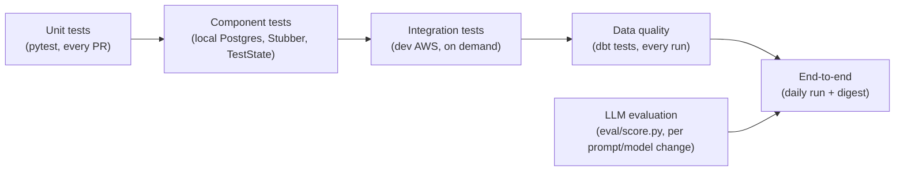

# Stellenradar – Test and Evaluation Plan

| Version | Date | Author | Status |
|---|---|---|---|
| 0.1 | 2026-10-20 | Prabhu Saravanan | Draft – in review |

Related documents: [PRD §8 success metrics](01-prd.md) · [SDD](03-sdd.md) · [Data model §7 quality rules](04-data-model.md) · [Security §12](05-security.md) · [Cost model §8](06-cost-model.md)

---

## 1. Objectives

1. Catch defects before they reach the daily run (no broken digest, no wrong data).
2. Prove every PRD success metric (SM-01 to SM-09) with evidence.
3. Measure LLM extraction accuracy honestly, per prompt version and model.
4. Prove re-runs are safe (idempotency) and failures clean up after themselves.

## 2. Test levels

| Level | What | Tools | When | Gate |
|---|---|---|---|---|
| Unit | Pure logic: hashing, BA response parsing, validation, skill normalisation, ranking helpers, digest rendering | `pytest`, `responses` (HTTP mocks), `botocore.stub.Stubber` | Every PR (CI) | Must pass; coverage ≥ 80% on `src/` |
| Component | Lambda handlers end-to-end with AWS mocked; DB migrations and pgvector queries on a real Postgres | `moto` (S3), Stubber (Bedrock, Athena), Docker image `pgvector/pgvector:pg16` | Every PR (CI) | Must pass |
| State machine | Individual states and Choice logic | Step Functions **TestState API** from a CI script; ASL validated with `aws stepfunctions validate-state-machine-definition` | PRs touching `statemachine/` | Must pass |
| Infrastructure | Terraform correctness and policy | `terraform fmt/validate`, `tflint`, `checkov`, `terraform plan` | Every PR | Plan must succeed; no new high checkov findings |
| SQL / dbt | Model compilation and tests on CI schema | `dbt build --target ci` | PRs touching `dbt/` or `sql/` | Must pass |
| Integration | Real AWS in `dev`: one component against real services | Make targets (`make it-ingest`, `make it-curate`, …) | Before merging a component's first version; after major changes | Checklist in §5 |
| Data quality | DQ-01 to DQ-10 | dbt tests, Step Functions Choice, metrics | Every daily run | dbt failure blocks the digest |
| LLM evaluation | Field accuracy on the labelled set | `eval/score.py` | Every prompt or model change | ≥ 90% overall (§4) |
| End-to-end / acceptance | Full daily run and digest | Scheduled run + checks in §6 | Week 3, 14-day observation | SM-01 to SM-09 |

## 3. Unit and component test catalogue

| Area | Test cases (minimum) |
|---|---|
| Ingest – BA client | Pagination stops on an empty page; throttle ≥ 1 s between calls; 429/5xx retried 4 times then raised; User-Agent set; one term failing sets `complete = false` |
| Ingest – change detection | New `refnr` → fetch; unchanged `list_hash` → skip; changed → fetch; `MAX_DETAILS` cap defers the rest; list index written only for fetched records |
| Ingest – manifest | Counts add up; time-budget stop records `details_deferred` |
| Curate | `content_hash` is stable across whitespace changes and changes when the description changes |
| Enrich – validation | Valid sample passes; out-of-range salary, min > max, unknown enum, wrong types each fail with a clear message; empty skills allowed |
| Enrich – normalisation | "PySpark", "Apache Spark", "spark" → `spark`; unknown skills kept lower-case |
| Enrich – handler | Invalid then valid response → 1 retry and success; invalid twice → dead letter; Bedrock throttling → retried by the botocore config; token counts returned |
| Embed | Skips versions already in the log; CV re-embedded only when the ETag changes |
| Match (Postgres container) | Upsert is idempotent; closed postings are deleted; top-N ordering by cosine distance is correct on a hand-built example |
| DB migrate | Migrations apply once in order; a re-run is a no-op; a failed migration rolls back |
| Digest | Renders 10 rows and the 0-row "no new matches" email; skips when the `sent` marker exists |
| Ranking (dbt unit tests) | Hard filters exclude applied, too-high German level and wrong seniority; `final_score` formula on fixed inputs |

**Test data:** BA responses recorded once during spike S1 and stored as fixtures under `tests/fixtures/ba/`, with contact names and phone numbers replaced by placeholders before committing (security doc §9). No real CV in fixtures – use a synthetic CV.

## 4. LLM extraction evaluation

### 4.1 Labelled set

| Property | Design |
|---|---|
| Size | 50 postings (PRD FR-10) |
| Selection | Stratified from the first week's data: ~40% German-only, ~20% English ads, ~20% with salary stated, ≥ 5 each of junior/mid, senior, lead+; ≥ 5 each of remote, hybrid, onsite |
| Split | **35 dev** (prompt iteration) / **15 holdout** (scored only for final results) – guards against tuning the prompt to the test set |
| Format | `eval/labelled_set.jsonl`: `{refnr, content_hash, text, labels: {9 fields}}`; text anonymised (contact names removed) |
| Labelling guide | `eval/labelling_guide.md`: one rule per field, e.g. "`english_only` = true only if the ad says German is not required or the ad is in English and mentions no German requirement"; "salary = yearly EUR; monthly × 12; ranges as min/max; 'competitive' → null" |
| Quality check | Re-label 10 postings after 3+ days without looking at earlier labels; disagreements > 5% of fields → clarify the guide and fix labels |

### 4.2 Scoring (`eval/score.py`)

| Field type | Fields | Counted correct when |
|---|---|---|
| Enum | `seniority`, `german_level_required`, `remote_policy` | Exact match (including both null) |
| Boolean | `english_only`, `visa_sponsorship_mentioned` | Exact match |
| Number | `salary_min_eur`, `salary_max_eur` | Both null, or within ±5% |
| Set | `skills`, `cloud_platforms` | Set F1 ≥ 0.8 (F1 also reported) |

- **Overall accuracy** = correct field judgements / (9 × number of postings).
- **Reported per run:** overall and per-field accuracy (dev, holdout, all), skills precision/recall/F1, **salary hallucination rate** (non-null prediction when the label is null), dead-letter count, average input/output tokens, cost per 1,000 postings.
- Results appended to `docs/evaluation.md`: date, model ID, prompt version, metrics.

### 4.3 Acceptance gate (SM-03)

| Criterion | Threshold |
|---|---|
| Overall accuracy, all 50 | **≥ 90%** |
| Holdout accuracy | ≥ 85% (lower means the prompt overfits the dev split) |
| Any single field | ≥ 75% |
| Salary hallucination rate | ≤ 2% |
| Invalid output after one retry | 0 on the labelled set |

The same gate is used to compare models for the cost decision ([cost model §4.2](06-cost-model.md)).

### 4.4 Matching quality (SM-06)

Over 5 consecutive digests, I rate each of the 10 matches "would consider applying: yes/no". Target: an average of ≥ 6/10. Ratings are recorded in `docs/evaluation.md` with the dbt weight settings used; changing the weights restarts the 5-day window.

## 5. Integration tests (dev AWS)

| ID | Test | Expected result |
|---|---|---|
| IT-01 | Ingest for one search term | Raw files and manifest in S3; counts plausible; requests ≥ 1 s apart in the logs |
| IT-02 | Curate on run 1, then run 2 with one edited and one removed posting (fixture-driven) | Edited posting has 2 versions; removed posting closed; others untouched |
| IT-03 | **Idempotency:** re-run curate and enrichment merge for the same `run_id` | Row counts and hashes identical before and after |
| IT-04 | Partial ingest (`complete = false`) | No postings closed |
| IT-05 | Enrichment Map with 1 forced-invalid item | 1 dead letter; run continues; metric emitted |
| IT-06 | Embed + match | Vectors in `vec.posting_vectors` = current postings; scores written |
| IT-07 | **CDC (SM-04):** insert, update, then delete a tracker row between two runs | `curated.applications` shows the insert, then the update, then `is_deleted = true` |
| IT-08 | CDC resume (spike S3) | Changes made between runs arrive once – no loss, no duplicates |
| IT-09 | **Failure cleanup:** force the `Match` Lambda to fail | Execution fails; DMS instance deleted; RDS stopping; one SNS email |
| IT-10 | dbt build after a successful run | All tests pass; marts populated |
| IT-11 | Digest | Email received; re-invocation does not send a second email |
| IT-12 | Lake Formation | `analyst` query on `curated.postings` denied; `gha-dbt` query cannot see `applications.notes` |
| IT-13 | Freshness alarm | Disable the schedule for 26 h in a test window → alarm email |

## 6. End-to-end and acceptance tests

| Success metric | How it is verified | Evidence |
|---|---|---|
| SM-01 Daily success ≥ 95% over 14 days | Step Functions execution history + GitHub Actions runs | Screenshot/table in `docs/evaluation.md` |
| SM-02 Freshness < 24 h | dbt source freshness results; alarm never fired | dbt artifacts |
| SM-03 Accuracy ≥ 90% | §4.3 | `docs/evaluation.md` |
| SM-04 CDC within one run | IT-07 | Query output |
| SM-05 Digest with 10 matches daily | Email received each day of the window | Email log / `sent` markers |
| SM-06 Relevance ≥ 6/10 | §4.4 | Ratings table |
| SM-07 Cost ≤ $30 | [Cost model §8](06-cost-model.md) | `docs/costs.md` |
| SM-08 Terraform coverage | `terraform plan` clean after apply; no console-created resources (Tag Editor search for untagged resources); `terraform destroy` tested once on a throwaway apply of core modules | Plan output |
| SM-09 Findings published | README section reviewed against marts | README |

## 7. Non-functional tests

| Area | Test |
|---|---|
| Reliability | IT-03, IT-04, IT-09; one intentional re-run of a full day |
| Performance | Daily run completes in < 60 min; match query < 2 s |
| Security | [Security §12](05-security.md) checklist; `checkov` in CI |
| Cost | 7-day projection in Week 3; Budget alerts confirmed by a test notification |
| Responsible use | Log check: ≤ 1 request/s to the BA API, one run per day |

## 8. CI quality gates

| Gate | Blocks merge? |
|---|---|
| `ruff check`, `ruff format --check` | Yes |
| `pytest` unit + component, coverage ≥ 80% on `src/` | Yes |
| `terraform fmt`, `validate`, `tflint`, `plan` | Yes |
| `checkov` | Yes for new high findings; others reported |
| `dbt build --target ci` (when `dbt/` or `sql/` changes) | Yes |
| `eval/score.py` (when `prompts/` or the model ID changes) | Yes – PR must include an updated `docs/evaluation.md` meeting §4.3 |

## 9. Schedule

| Week | Testing focus |
|---|---|
| 1 | Unit tests for ingest and curate; spikes S1, S2, S4; IT-01 to IT-04; collect the 50 postings for labelling |
| 2 | Labelling + evaluation (§4); unit/component tests for enrich, embed, match, migrations; spike S3; IT-05 to IT-08 |
| 3 | dbt tests; IT-09 to IT-13; security checklist; 14-day acceptance window starts as early as possible (SM-01 may complete after Week 3) |

## 10. Defect handling

Defects are GitHub issues labelled `bug` with severity:
- **S1** – wrong data published, or personal data exposed: stop the schedule, fix immediately.
- **S2** – run fails or digest missing: fix before the next run.
- **S3** – cosmetic or minor: backlog.

Every S1/S2 gets a regression test before it is closed.
